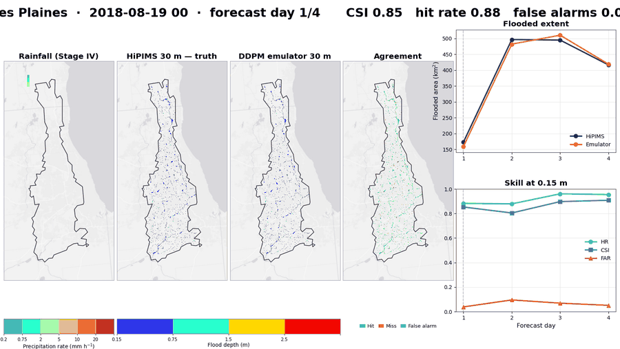
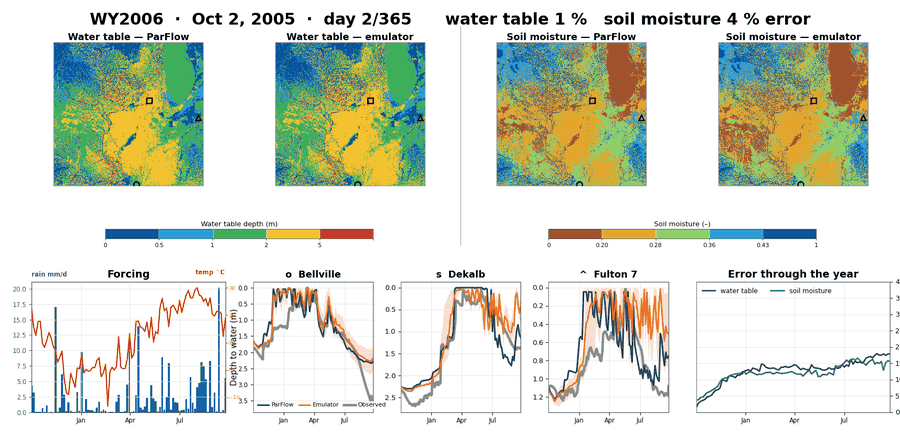
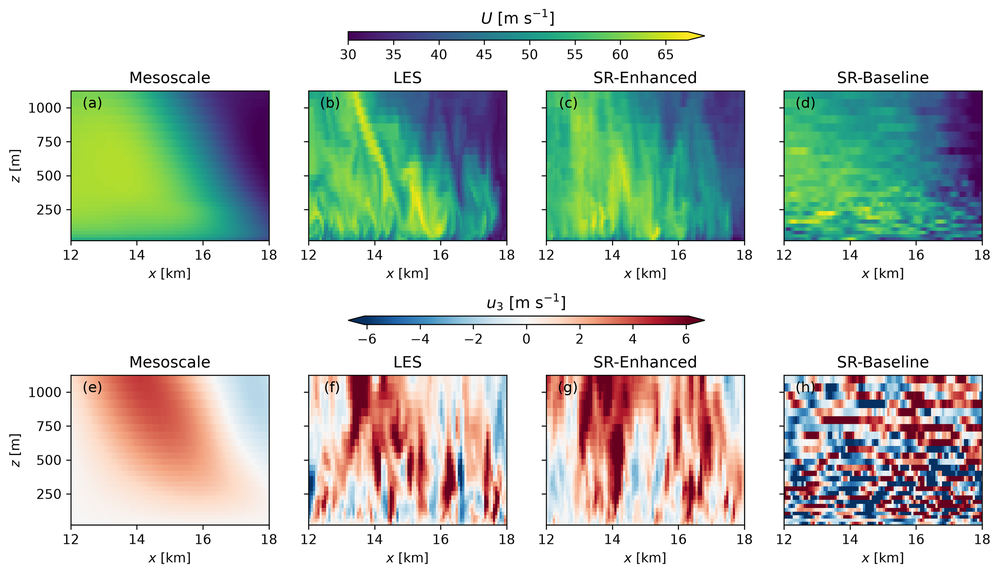
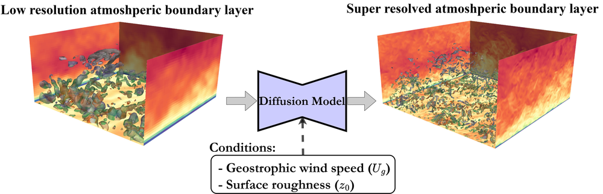

## Omar Sallam

Postdoctoral Appointee, Environmental Science Division, Argonne National Laboratory.

I develop generative AI emulators for complex spatiotemporal physical systems: conditional diffusion models that
turn a cheap simulation or atmospheric forcing into the expensive high-fidelity field, fast enough to run as
ensembles. Applications range from atmospheric turbulence and tropical cyclones to flood and groundwater
forecasting.

**Research interests:** generative models (diffusion) · physics emulation and super-resolution · flood and
hydrologic forecasting · turbulence and atmospheric boundary layers · scientific machine learning on HPC

---

### Medium-range and seasonal surface-water and groundwater forecasting (Argonne, 2025 – present)

Diffusion emulators for the US Midwest, to be extended to CONUS: 30 m flood depth from SynxFlow/HiPIMS
simulations, and 1 km groundwater and soil moisture from ParFlow-CLM, rolled out autoregressively for a full
water year and driven by ECMWF SEAS5 seasonal forecasts.

  

Held-out storm, Des Plaines watershed: 30 m flood depth from the simulation and the emulator
(critical success index 0.84, against 0.35 for the coarse input).

  

360-day groundwater rollout against ParFlow-CLM and observation wells
(water-table nRMSE 13.3 % after one year).

### Spatiotemporal super-resolution of tropical cyclones (NREL, 2024 – 2025)

Conditional diffusion super-resolution of hurricane wind fields from a 1.5 km mesoscale simulation to
large-eddy-simulation resolution, coupled with a neural operator to advance the turbulent field in time.

  

### Super-resolution of atmospheric boundary layer LES (Texas A&M, 2020 – 2024)

A diffusion model that reconstructs high-resolution LES of the atmospheric boundary layer from coarse simulations
(x2 to x8), conditioned on wind speed and surface roughness, for wind-energy inflow.

  

---

### Publications

- **Sallam, O.**, et al. (2025). Tropical cyclone super resolution using conditional diffusion denoising
  probabilistic model from mesoscale simulation to LES. *Environmental Research Communications*, 7, 125025.
  [doi:10.1088/2515-7620/ae2a96](https://doi.org/10.1088/2515-7620/ae2a96)
- Si, P., Qiu, Y., **Sallam, O.**, Feinstein, J., He, Z., Yan, E., Chen, P. (2026). Toward AI-driven digital
  twins for metropolitan floods: a conditional latent dynamics network surrogate of the shallow water equations.
  *Journal of Hydrology*, 680, 136461.
- Sanchez Gomez, M., King, R., Glaws, A., **Sallam, O.** (2026). Reconstructing and time-advancing coherent
  turbulence in tropical cyclones using diffusion super-resolution. *ESS Open Archive* (preprint).
  [doi:10.22541/essoar.15009263/v1](https://doi.org/10.22541/essoar.15009263/v1)
- **Sallam, O.**, Fürth, M. (2026). Conditional diffusion denoising probabilistic model for super-resolution of
  atmospheric boundary layer large eddy simulation. Preprint.
- **Sallam, O.**, et al. Flood forecasting using a physics-guided conditional diffusion denoising probabilistic
  model. Under review.

### Selected repositories

| Repository | Description |
|---|---|
| [ceser_usgs_gage_hydraulic_geometry](https://github.com/okhsallam/ceser_usgs_gage_hydraulic_geometry) | Hydraulic geometry and channel bathymetry for 88 USGS gages in the Upper Mississippi and Illinois basins |
| [Dual-Scale-Residual-Network-for-2D-turbulent-flows](https://github.com/okhsallam/Dual-Scale-Residual-Network-for-2D-turbulent-flows) | Dual-scale residual network for sub-grid-scale resolving of 2-D turbulence |
| [Variational-AutoEncoder-for-Two-phase-flow-compression-and-reconstruction](https://github.com/okhsallam/Variational-AutoEncoder-for-Two-phase-flow-compression-and-reconstruction) | Variational autoencoder for compression and reconstruction of two-phase turbulent flow |
| [xcompact3d_faster_ABL](https://github.com/okhsallam/xcompact3d_faster_ABL) | Building Xcompact3d for atmospheric boundary layer LES on HPC systems |

### Contact

omarkhaledsallam@gmail.com
